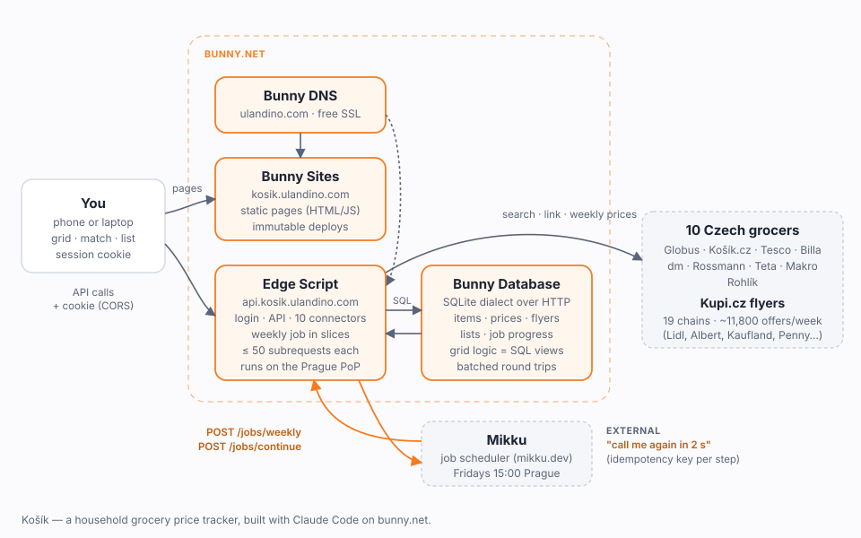

# Paternity leave, a Makro receipt, and a grocery price tracker on bunny.net's edge

*How Claude Code and I built Košík in a week: ten Czech stores, one Edge Script, zero servers.*

We had a few-weeks-old baby, and our household ran on one ritual: the big Friday-evening shop. Every week I'd stand in Makro wondering whether the 16-pack of toilet paper in my cart was actually cheap, or just big.

So on paternity leave, with a baby asleep on my chest and one free hand, I opened a terminal and started a conversation with Claude Code. I didn't want to "build an app". I wanted an answer to one question each Friday: **where is each thing on my list cheapest this week?**

A week later that question has an answer at kosik.ulandino.com. It runs entirely on bunny.net: Bunny Database, Edge Scripting, a static site and Bunny DNS. The weekly price refresh is triggered by Mikku, a job scheduler a colleague built. This post covers how that happened, who did what, what it actually saves, and the platform gotchas we hit on the way.



## Start with the receipt

The first input was a photo of my Makro receipt: 32 lines with barcodes, VAT rates and pack sizes. Claude Code turned it into a watchlist, then pushed back on my first idea of one row per product.

Its argument was that I don't care about *Harmony 4-ply 16 rolls*; I care about *the cheapest 4-ply toilet paper*. So the data model became three layers:

- **offering**: one listing at one store, with its price history;
- **product**: the same physical item across stores, joined by barcode;
- **need**: my own grouping ("still water, per litre", "chicken liver, any brand, per kg").

Every price is normalized to a sensible unit (per kg, per litre, per roll, per egg), so a 9-litre six-pack and a 1.5-litre bottle compare fairly.

That model survived every pivot that followed. Most of the logic ended up as SQL views: a matrix of rows × stores with the cheapest cell marked. That turned out to matter a lot later.

## Ten stores, ten different ways in

Most of the week went into the part nobody sees: getting prices out of Czech grocers. My rule was "if it's on a public website, find the request behind it". Claude Code did the detective work. It read network requests in my logged-in browser, dug through JS bundles for GraphQL endpoints, and sent survey agents out in parallel, three at a time, to report which stores were worth connecting.

What we ended up with:

- **Rohlík:** an autocomplete endpoint returns product ids (8 by default, up to 60 if you ask), then a card endpoint returns prices, 20 ids at a time. No barcodes, so matching is by name, once per item.
- **Globus:** a public Shopsys GraphQL API. Search by barcode (fuzzy, so we check for an exact match), then batch prices by catalogue number.
- **Tesco:** the website is behind bot protection, but the web app's own GraphQL gateway answers with a public client key, at most ten operations per request. Clubcard prices only exist as text ("119,90 Kč … s Clubcard"), so we parse them.
- **Košík.cz, dm, Billa:** clean JSON. Billa prices are in haléře, and during a promo its field called "regular" holds the *promo* price.
- **Rossmann and Teta:** both use Luigi's Box search. An unknown barcode returns fuzzy junk, so every hit is verified.
- **Makro:** my home store turned out to need no login. The anonymous search returns the price *without VAT* per pack, and adding the item's VAT reproduces my receipt to the haléř: butter 52.30 → 58.58, Pampers 369.00 → 446.49.
- **Kupi.cz:** a flyer aggregator for the chains that only publish weekly promos (Lidl, Albert, Kaufland, Penny). It's server-rendered HTML with validity windows, loyalty-card conditions and "buy two" small print. It gets its own "flyer deal" column in the grid rather than pretending to be a store.

This week's full flyer crawl collected **11,801** current offers across 19 chains.

For items with no barcode, like everything I'd ever ordered from Rohlík, a job searches Globus and Tesco by name. It scores candidates on name overlap, brand, fat percentage and pack size, then asks me to confirm. I imported all 14 of my Rohlík orders (265 products) that way. The side result was a nice table: the same basket I bought in early 2024 costs 5.3 % more today.

## From laptop to edge

For the first few days Košík was a Python script and a local SQLite file, which is how things start. Then I said the obvious thing out loud: I work at bunny.net, so let's put this on bunny.net.

The first move was **Bunny Database**: the same SQLite dialect over HTTP. Claude Code wrote a small adapter that looks like Python's `sqlite3` module, so all the existing code worked unchanged. It copied the data up and then diffed the output of both backends. They were byte-identical.

Next came the part I was nervous about: would Czech stores answer requests from a CDN data centre the way they answer my laptop? Before porting a line, Claude Code deployed a probe **Edge Script** that called every store and reported status, timing and result counts. The script ran on the Prague PoP, the outgoing IP geolocated to Prague, all ten stores answered in 90–450 ms, and Kupi even labelled the request "Praha". That one probe de-risked the whole migration.

After that, the port was mostly mechanical:

- The **API** became one Edge Script in TypeScript. It reuses the database views, so the read side is thin, and every endpoint sends its queries to Bunny Database as **one batched round trip**.
- The **pages** are a Bunny static site, deployed with `bunny sites deploy`. Every deploy is immutable, so a rollback is one command.
- **DNS** moved to Bunny DNS: two CNAMEs and two free certificates, all from the CLI.
- The **login** is one household password that sets an HMAC-signed cookie, checked on the edge with WebCrypto and no libraries.

Every port was checked against the Python original. The grid, the match data and the shopping list came out byte-identical, and 17 live store searches returned the same data field by field.

## Long jobs in short requests

An Edge Script request gets about 30 s of CPU and at most **50 subrequests**, and every database query counts as one. A full flyer crawl is about 400 page fetches. So the weekly job runs in slices: store prices in each store's batch size, then 12 Kupi pages per slice, then barcode lookups. Progress lives in a `job_run` row.

This is where Mikku comes in. At 15:00 every Friday (Prague time) its schedule calls `/jobs/weekly`. After each slice, the Edge Script publishes the next step back to Mikku with an idempotency key. Each step is **claimed** atomically in the database, so a retried delivery can never run a slice twice:

```ts
const claim = await run(
  "UPDATE job_run SET claimed=? WHERE id=? AND status='running' AND step=? AND claimed<?",
  step, id, step - 1, step);
if (!claim.rowsAffected) return { skipped: true };  // someone else has this step
```

The full run takes **79 slices over about 30 minutes**. By the time I'm home on Friday, the grid is fresh.

## So, does it save anything?

To answer that honestly I skipped the generic "milk, eggs, bread" basket, where every store sells a different brand, and picked six things we actually buy, matched by **exact barcode** (or exact name and pack where a store hides barcodes):

| Item | Stores | Cheapest | Most expensive |
|---|---|---|---|
| Pampers Premium Care 1, 72 pcs | 8 | Rossmann 289 Kč | Košík.cz 499 Kč |
| Philadelphia Original 200 g | 2 | Rohlík 59.90 Kč | Globus 79.90 Kč |
| Meggle lactose-free milk 1.5 %, 1 l | 6 | Billa 29.90 Kč | Rohlík / Košík.cz 49.90 Kč |
| Mlynářova bread flour 1 kg | 2 | Rohlík 25.90 Kč | Globus 33.90 Kč |
| Caputo Pizzeria "00" flour 1 kg | 3 | Makro 46.93 Kč | Rohlík 109.90 Kč |
| Activia plain white 4 × 120 g | 5 | Globus 39.90 Kč | Košík.cz 74.90 Kč |

Same products, same pack sizes. The basket costs:

| Scenario | Total | Stores |
|---|---|---|
| Cheapest | **491 Kč** | 5: Rossmann, Rohlík, Billa, Makro, Globus |
| Efficient run | **525 Kč** | 3: Globus, Makro, Rossmann |
| Two stores | 608 Kč | Rossmann + Rohlík |
| Average | 655 Kč | whatever store you happen to be in |
| Most expensive | 847 Kč | |

Two numbers stand out:

- **Against the average, the cheapest basket saves 164 Kč, or 25 %.** That's the realistic comparison: what you'd pay without checking.
- **Cheapest against most expensive is a 356 Kč gap.** The priciest way to buy the exact same six products costs 73 % more than the cheapest (the cheapest is 42 % less).

Nobody visits five stores for six items, which is why the **efficient run** exists: the best combination of one to three stores, by coverage first and then total. Three stores gets within 34 Kč of the absolute cheapest and still saves 130 Kč (20 %) against the average. No single store carries all six, which surprised me more than any price did.

A few honest footnotes. Makro needs a business card, and its price is net plus VAT. Philadelphia 200 g and the Mlynářova flour are only at two stores; everywhere else sells a different pack or brand, and I kept exact matches rather than lookalikes. None of the six were on a flyer promo this week, so these are shelf prices.

## Gotchas worth knowing

- **Pull zones strip cookies by default.** My login worked, but the browser never received the session cookie. "Disable Cookies" is on for new pull zones, which silently removes `Set-Cookie`. One `bunny api` call turned it off, and every response now defaults to `Cache-Control: no-store`.
- **Script variables apply on the next deploy.** I set the Mikku API key, and the running script kept seeing the old one until I redeployed.
- **Deploys take a few seconds to go live.** Right after `bunny scripts deploy`, the old version still answered for a few seconds. Give it about 10 s before you test.
- **50 subrequests means batching.** Linking a product used to be several writes per offer. On the edge it's one `db.batch`, with each price finding its listing through a subquery instead of reading back ids.
- **JavaScript's `\b` doesn't know Czech.** A straight Python-to-TypeScript port of the unit parser would silently miss "8 rolí" and "72 plenek". With Unicode-aware word boundaries it matches the Python version on all 3,680 product names in the database.
- **A domain pointed at bunny but not configured** shows a 403 "Domain suspended or not configured" page, over a `*.b-cdn.net` certificate. A tiny static site makes a friendlier parking page.

## Working with Claude Code

I made the product calls, and they shaped everything: needs rather than duplicate rows, Kupi as a flyer layer rather than a store, one weekly run to match our Friday shop, and English display names with Czech search text.

Claude Code did the investigation, the porting and, importantly, the checking. It diffed every port against the original, tested on throwaway data, and backed up my shopping list before touching it.

It wasn't flawless. A test once "borrowed" my butter's store listings and deleted them on cleanup. It fixed the data within minutes, then fixed the real bug that made that possible, which could have hit me too. It also once printed a job secret into our session and rotated it straight away. I'd rather have an agent that finds and owns those mistakes than one that hides them.

## What's next

A phone-sized list view for the store aisle, and more of our regulars matched by barcode, since exact matches are where the numbers are most trustworthy. But mostly I'm going to use it. It's Friday soon.

*Košík is a personal tool. Prices are used for one household and never redistributed.*
