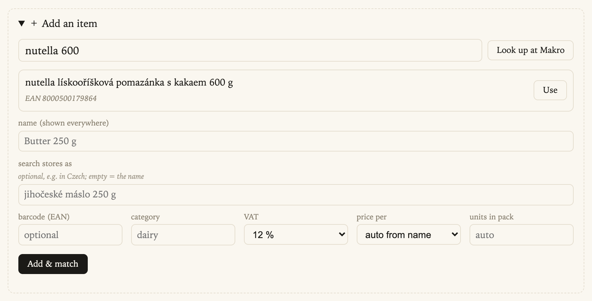
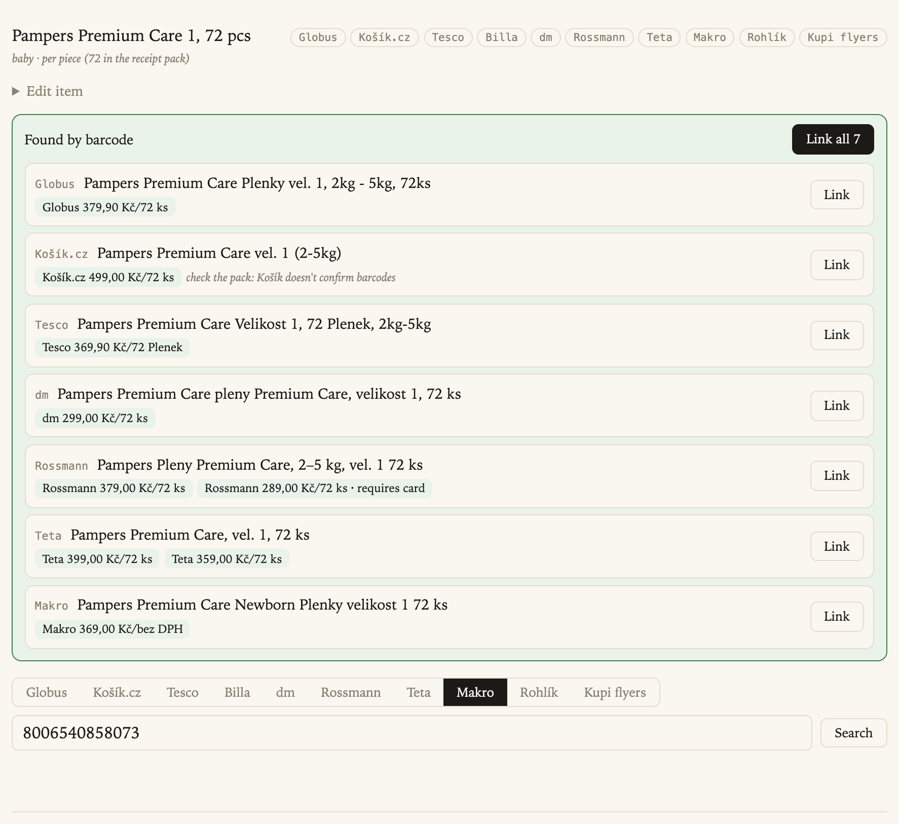
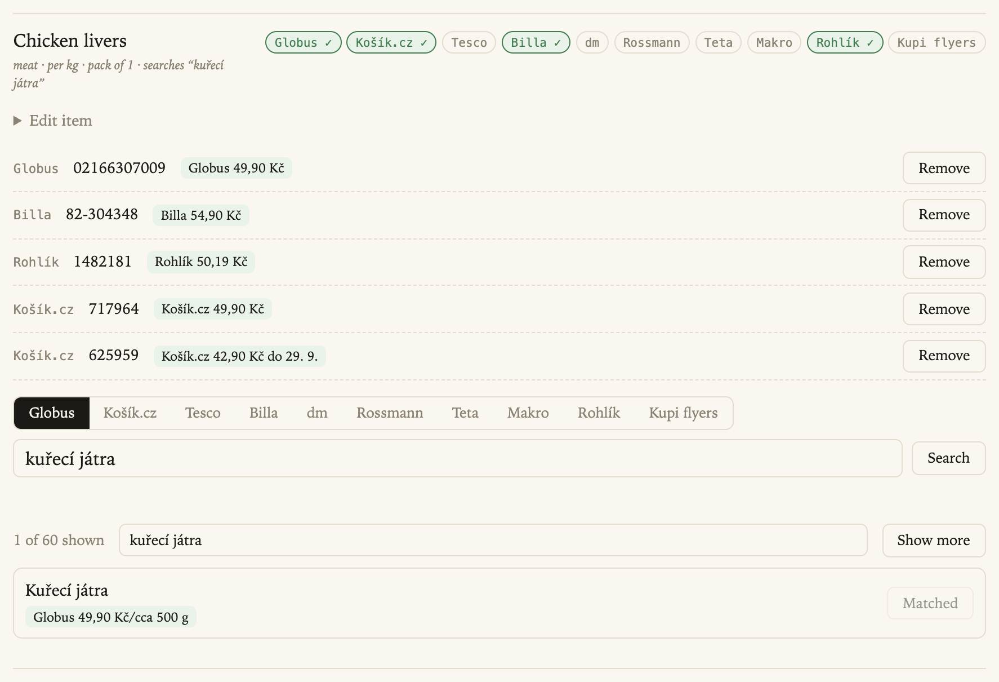
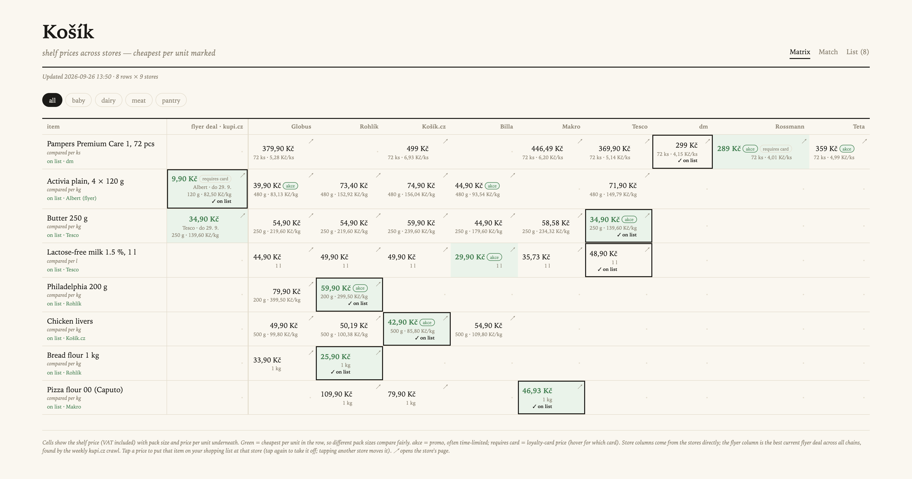
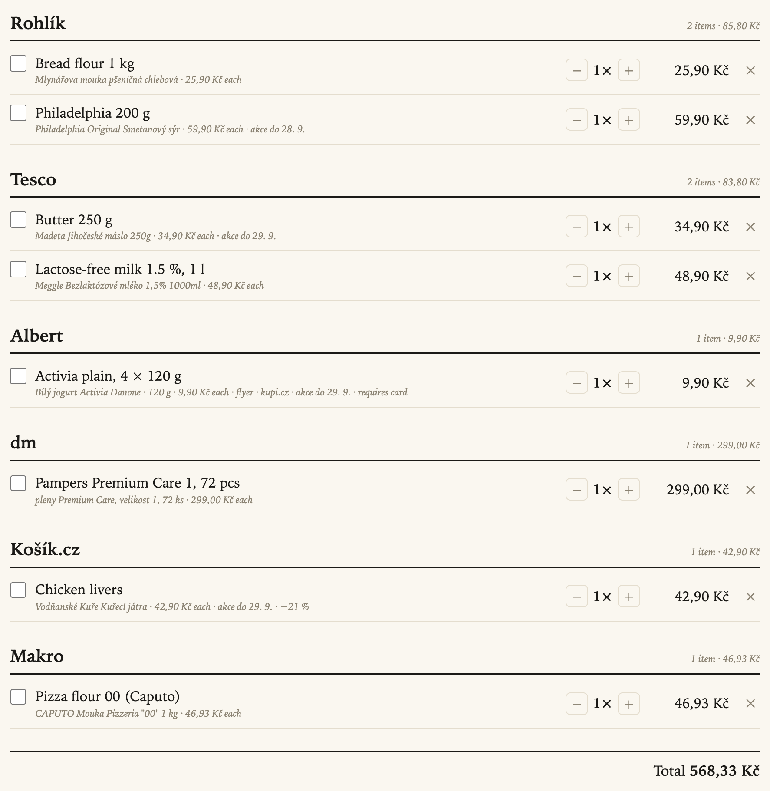
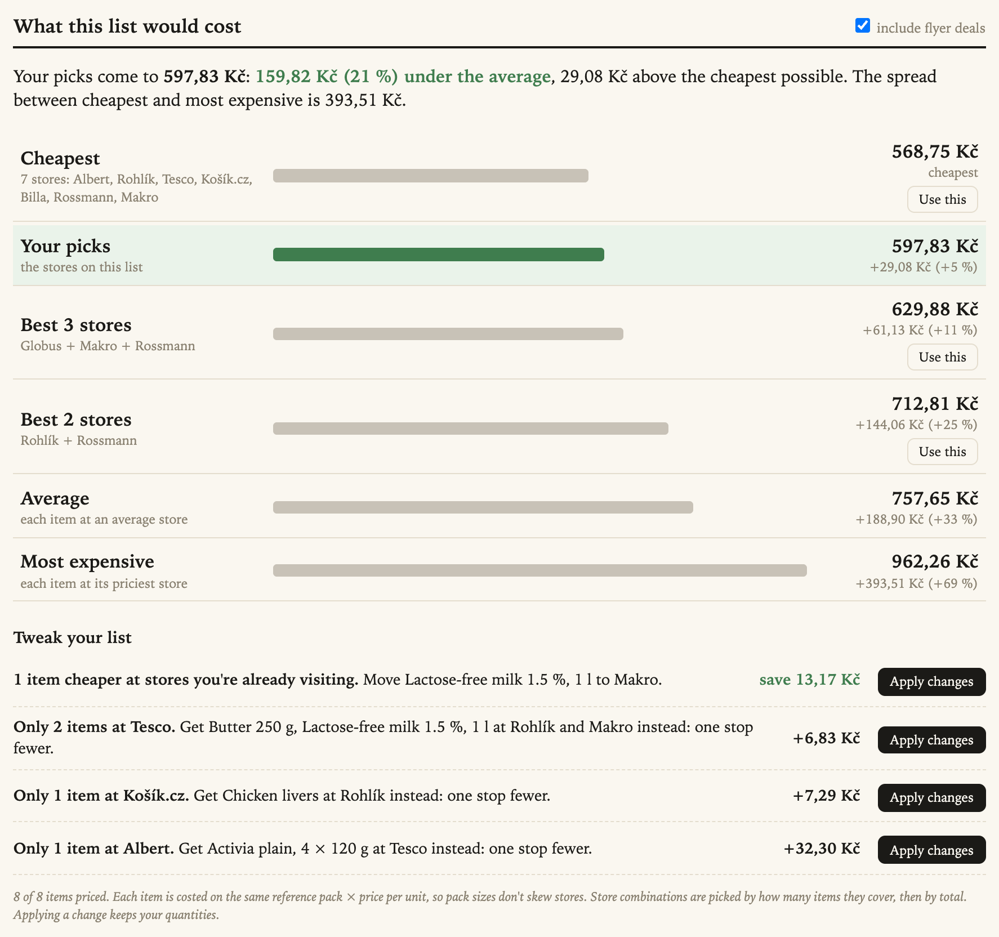
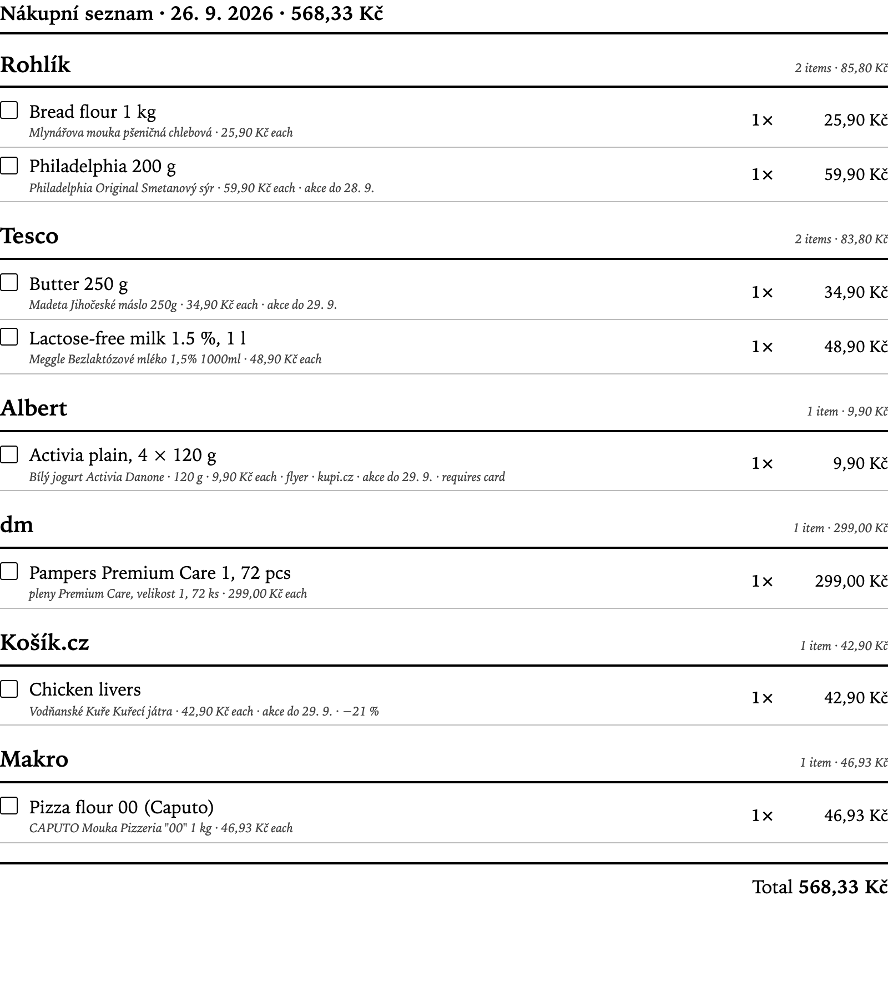
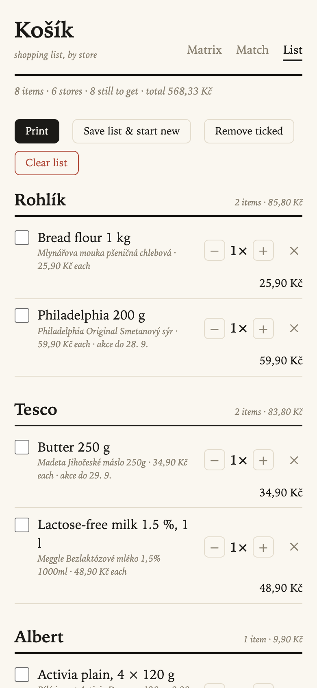

# Using Košík

A week with Košík looks like this:
1. Add the things you buy (once).
2. Refresh prices (weekly, or automatically).
3. See where everything is cheapest.
4. Tap your picks onto a list.
5. Check what the list costs.
6. Print it and shop.

The screenshots use a demo basket of eight items with real prices from late September 2026.
Your numbers will differ.

- [1. Add the things you buy](#1-add-the-things-you-buy)
- [2. Refresh prices](#2-refresh-prices)
- [3. Read the matrix](#3-read-the-matrix)
- [4. Build your shopping list](#4-build-your-shopping-list)
- [5. See what your list costs](#5-see-what-your-list-costs)
- [6. Print it, or take it on your phone](#6-print-it-or-take-it-on-your-phone)
- [Tips and FAQ](#tips-and-faq)

---

## 1. Add the things you buy

Everything starts on the **Match** page. An item is something you buy, like "Butter 250 g".
You link it once to the matching product at each store, and from then on Košík fetches those
prices by id.

Open **+ Add an item**:

| Field | What it's for |
|---|---|
| **name** | What you see everywhere, in any language. *"Lactose-free milk 1.5 %, 1 l"* |
| **search stores as** | What to type into the stores' search boxes, usually Czech. *"Meggle bezlaktózové mléko 1,5"*. Empty means the name is used. |
| **barcode (EAN)** | Optional, but the fastest route to exact matches (see below). |
| **category** | Filters the matrix: dairy, baby, pantry… |
| **VAT** | 12 % for food, 21 % for most other things. Used for Makro, which lists prices without VAT. |
| **price per / units in pack** | How items are compared: per kg, l, roll, egg or piece. "auto from name" gets it right most of the time. |

Don't know the barcode? Type a name or barcode and press **Look up at Makro**. **Use** fills in
the barcode and the Czech name for you.

Then press **Add & match**, and the item opens so you can link it.

### Example: an exact product, by barcode

If an item has a barcode, opening it asks every store that knows barcodes (Globus, Tesco,
Makro, dm, Rossmann, Teta) plus Košík.cz by name. You get exact matches back:

**Link all 7** and you're done: the same 72-pack of Pampers is now tracked at seven stores.
Things to notice:

- **Rossmann shows two prices.** 379 Kč on the shelf, and 289 Kč **requires card** (its
  loyalty club). Card prices are always labelled, so you can decide whether they count for you.
- **Makro shows the price without VAT** (*bez DPH*). Košík adds the item's VAT before comparing.
- **Košík.cz doesn't confirm barcodes,** so its match comes from the name. Check the pack size
  before linking.

### Example: a generic item, by name

Some things you don't buy by brand. For "Chicken livers" any brand will do, and what matters is
the price per kg. Leave the barcode empty, set **price per** to *kg*, and link whichever
products you'd happily buy, even **several at the same store**:

- The tabs (**Globus**, **Košík.cz**, … **Kupi flyers**) choose which store to search.
- Store searches return up to 60 results. Type in the **filter** box (*"kuřecí játra"*, *"6x"*,
  *"1,5"*) to narrow them down, or press **Show more**.
- Already-linked products show **Matched**. **Remove** unlinks one.
- The matrix always shows the cheapest per kg of everything linked at that store. Here that's
  two different brands at Košík.cz.

### Flyer deals (Lidl, Albert, Kaufland, Penny…)

Chains without an online shop only publish weekly flyers. Search the **Kupi flyers** tab and
link the product, e.g. *"Bílý jogurt Activia Danone"*. From then on, whenever any chain has it
on a flyer, the best deal shows up in the matrix's flyer column. If Kupi lumps several pack
sizes together, tick the ones you actually buy.

### Items without a barcode

Imported or hand-typed items often have no barcode. **Find barcodes** searches Globus and
Tesco by name and suggests likely barcodes, each rated *strong*, *good* or *weak*. **Use this
barcode** sets it and runs the barcode match across all stores. **None of these** stops the
suggestions for that item.

---

## 2. Refresh prices

Prices are fetched when you link something, and then refreshed in bulk:

| Button (Match page) | What it does | Takes |
|---|---|---|
| **Refresh everything** | Store prices, then every current flyer, then barcode suggestions | ~30 min |
| **Refresh store prices** | Just the stores you've linked | a minute or two |
| **Crawl Kupi flyers** | Every current flyer offer from 19 chains (~12,000 a week) | ~25 min |
| **Find barcodes** | Barcode suggestions for items without one | depends on how many |

If your deployment has a **Mikku** key, "Refresh everything" also runs by itself every Friday
afternoon, and the buttons run in the background. Without Mikku, **keep the Match page open**
while a refresh runs. If you close it, the refresh picks up where it left off when you open the
page again within 20 minutes; after that, start it again.

---

## 3. Read the matrix

The **Matrix** is the weekly overview: your items down the side, the stores across the top.

Each cell shows:
- the **shelf price** you'll pay (VAT included), big;
- the **pack size** and **price per unit**, small.

Pack sizes differ, so **the cheapest cell is decided per unit** and marked green. That's why
Activia's green cell is a single 120 g cup at Albert (9.90 Kč, i.e. 82.50 Kč/kg), which beats
the 480 g four-packs everywhere else per kg.

| Mark | Meaning |
|---|---|
| green cell | cheapest per unit in the row |
| **akce** | a promo price, often with an end date ("do 29. 9.") |
| **requires card** | a loyalty-card price (hover to see which card) |
| **flyer deal · kupi.cz** column | the best current flyer deal from any chain, with the chain and the dates |
| ↗ | opens the product on the store's website |
| empty dot | not linked at that store (or not sold there) |

The category pills (**all**, **baby**, **dairy**…) filter the rows.

**Tap a price to put that item on your list at that store.** The cell gets a frame and "✓ on
list". Tapping another store's price moves the item there, and tapping the same one again takes
it off. You don't have to pick the green cell. Maybe you're at Tesco anyway, and 48.90 Kč for
milk beats a trip to Billa for 29.90 Kč.

---

## 4. Build your shopping list

The **List** page groups your picks by store, in the order you'd walk them:

- **Tick** things off as you go. Ticked items sink to the bottom of their store.
- **− / +** changes the quantity; **×** removes a line.
- If a price has changed since you added it, the line says **now X Kč**.
- **Remove ticked** clears what you've bought. **Clear list** starts over.
- **Save list & start new** keeps a copy with that day's prices. Under **Saved lists** you can
  **Open** one (read-only and printable) or **Use again**, which puts its items back on the list
  at today's prices. Handy for a "usual weekly shop".

---

## 5. See what your list costs

Under the list, **What this list would cost** puts your picks next to the alternatives:

- **Your picks** is your list as it stands, highlighted in green. The headline compares it with
  the average (*"159.82 Kč (21 %) under the average"*) and the cheapest possible.
- **Cheapest** buys every item wherever it's cheapest, which is usually lots of stops (seven here).
- **Best 3 stores / Best 2 stores** are the cheapest combinations of that many stores that still
  cover everything on the list.
- **Average** and **Most expensive** show what you'd pay without checking, or with bad luck.
- **Use this** moves your whole list to that combination.
- **include flyer deals** decides whether flyer prices count.

Items are compared like for like: each is costed on the same reference pack at every store, so a
single cup and a four-pack don't skew the totals.

### Tweak your list

The tips suggest changes that keep your route simple:

- **"1 item cheaper at stores you're already visiting."** The milk is 13.17 Kč cheaper at Makro,
  and Makro is on your route anyway: a free saving.
- **"Only 2 items at Tesco."** Get the butter and milk at Rohlík and Makro instead. It costs
  6.83 Kč more but saves a whole stop.
- **"Only 1 item at Albert."** Skipping Albert for the Activia costs 32.30 Kč. Maybe worth it,
  maybe not.

**Apply changes** moves those lines on your list (quantities stay) and recalculates everything.
Nothing changes unless you click.

---

## 6. Print it, or take it on your phone

**Print** gives a clean black-and-white checklist with store headings, boxes to tick,
quantities and subtotals. The List page also works on a phone in the store aisle:

&nbsp;

---

## Tips and FAQ

**The flyer price is for one cup, but I buy a four-pack.** Flyer deals are often per piece. Set
the quantity to 4 on the list; the matrix already compares per kg.

**Why is a store missing for an item?** Either it isn't linked there (open the item on Match
and search that store's tab) or the store doesn't sell it. Some products only come in other pack
sizes at some stores. That's fine for a generic item, but for an exact item keep only exact
matches.

**Tesco never shows up.** Tesco needs its web API key (`TESCO_XAPI_KEY`) in the deployment's
settings. See [Options](../../README.md#options).

**Do card prices count?** They're used like any other price but always labelled **requires
card**, so you can see when a "cheapest" depends on a loyalty card.

**How fresh are the prices?** Linking fetches right away. After that, prices are as fresh as the
last refresh: weekly with Mikku, or whenever you press **Refresh everything**. Flyer deals carry
their own dates.

**Can I rename items or change what they search for?** Open the item on Match → **Edit item**.
Changing the name doesn't change the search text, so an English name keeps searching in Czech.
